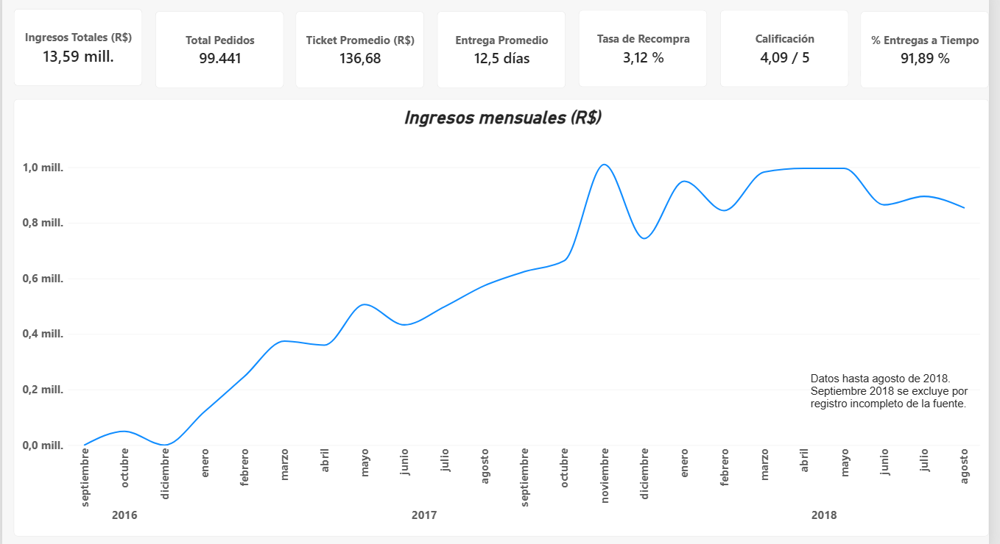
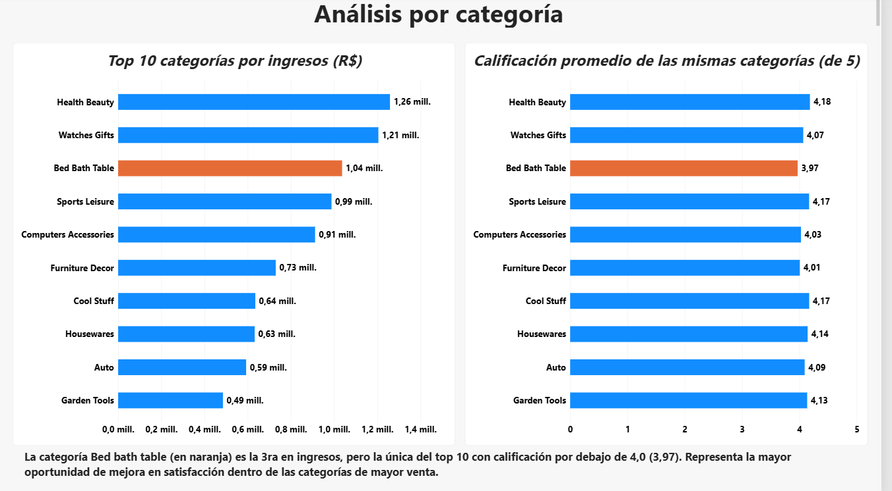
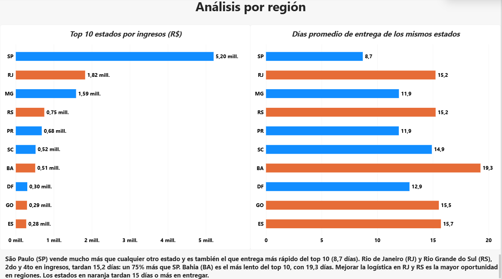
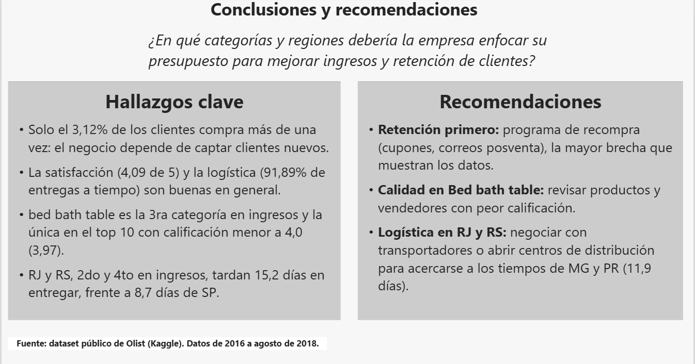

# Análisis de ventas de Olist (Power BI)

Dashboard en Power BI sobre el e-commerce brasileño Olist, construido para responder una pregunta de negocio:

> *¿En qué categorías y regiones debería la empresa enfocar su presupuesto para mejorar ingresos y retención de clientes?*

## Resultados principales

| Indicador | Valor |
|---|---|
| Ingresos totales | R$ 13,59 millones |
| Pedidos | 99.441 |
| Ticket promedio | R$ 136,68 |
| Entrega promedio | 12,5 días |
| Entregas a tiempo | 91,89% |
| Calificación promedio | 4,09 de 5 |
| Tasa de recompra | 3,12% |

## Hallazgos

1. *Casi nadie vuelve a comprar.* Solo el 3,12% de los clientes compra más de una vez, así que el negocio depende de captar clientes nuevos.
2. *La operación funciona bien en general:* calificación de 4,09 de 5 y 91,89% de entregas a tiempo.
3. *Bed Bath Table* es la 3ra categoría en ingresos, pero la única del top 10 con calificación por debajo de 4,0 (3,97).
4. *São Paulo (SP)* vende mucho más que cualquier otro estado y es el que entrega más rápido del top 10 (8,7 días). *Rio de Janeiro (RJ)* y *Rio Grande do Sul (RS), 2do y 4to en ingresos, tardan 15,2 días: un 75% más que SP. **Bahia (BA)* es el más lento del top 10, con 19,3 días.

## Recomendaciones

- *Retención primero:* programa de recompra (cupones, correos posventa), la mayor brecha que muestran los datos.
- *Calidad en Bed Bath Table:* revisar productos y vendedores con peor calificación.
- *Logística en RJ y RS:* negociar con transportadores o abrir centros de distribución para acercarse a los tiempos de MG y PR (11,9 días).

## Dashboard

*Página 1. Resumen:* 7 indicadores clave e ingresos mensuales.

*Página 2. Análisis por categoría:* top 10 categorías por ingresos y su calificación promedio.

*Página 3. Análisis por región:* top 10 estados por ingresos y sus días promedio de entrega.

*Página 4. Conclusiones y recomendaciones.*

## Cómo lo hice

- *Datos:* dataset público de Olist en Kaggle (9 archivos CSV), pedidos de 2016 a agosto de 2018. Septiembre de 2018 se excluyó porque el registro de la fuente está incompleto.
- *Limpieza en Power Query:* tipos de datos, traducción de categorías al inglés y limpieza de nombres (guiones bajos por espacios y mayúscula inicial en cada palabra).
- *Modelo de datos:* relaciones entre las tablas de pedidos, productos, clientes y reseñas, más una tabla de calendario para el análisis en el tiempo.
- *Medidas DAX:* ingresos, ticket promedio, tiempo de entrega, porcentaje de entregas a tiempo, calificación promedio y tasa de recompra. Ejemplo:

DAX
% Entregas a Tiempo =
VAR PedidosEntregados =
    FILTER ( Orders, NOT ( ISBLANK ( Orders[order_delivered_customer_date] ) ) )
VAR PedidosATiempo =
    FILTER (
        PedidosEntregados,
        Orders[order_delivered_customer_date] <= Orders[order_estimated_delivery_date]
    )
RETURN
    DIVIDE ( COUNTROWS ( PedidosATiempo ), COUNTROWS ( PedidosEntregados ) )

- *Visualización:* formato condicional para resaltar en naranja los casos que requieren atención (calificación menor a 4 y entregas de 15 días o más).

## Archivos

- proyecto-olist.pbix: el dashboard completo. Se abre con Power BI Desktop (gratis).
- images/: capturas de las 4 páginas.

## Herramientas

Power BI Desktop, Power Query, DAX.

## Autor

*Miguel Santiago Firstman Santacruz*, estudiante de Finanzas y Negocios Internacionales (Universidad Autónoma del Cauca, Popayán, Colombia).