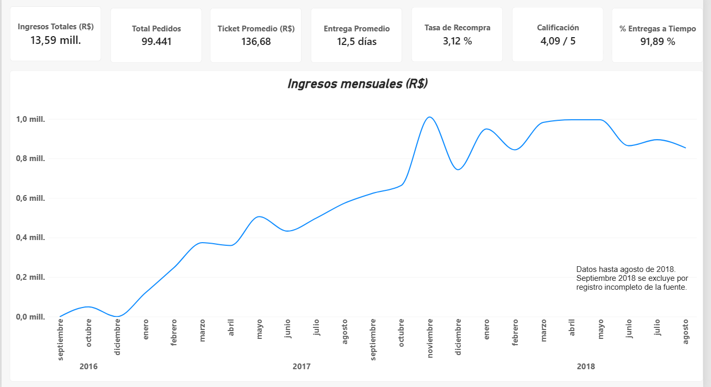

# Portafolio de análisis de datos

Soy *Miguel Santiago Firstman Santacruz*, estudiante de Finanzas y Negocios Internacionales en la Universidad Autónoma del Cauca (Popayán, Colombia). En este repositorio están mis proyectos de análisis de datos, cada uno construido alrededor de una pregunta de negocio real.

## Proyectos

### [Análisis de ventas de Olist (Power BI)](Olist-Power-BI)

¿En qué categorías y regiones debería un e-commerce enfocar su presupuesto para mejorar ingresos y retención de clientes? Dashboard de 4 páginas con datos reales de Olist (Brasil, 2016 a 2018).

*Herramientas:* Power BI, Power Query, DAX

## Próximamente

Proyectos de análisis con SQL y Python.
